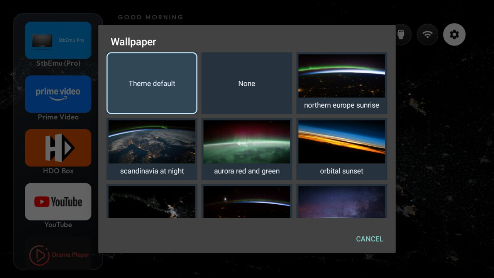
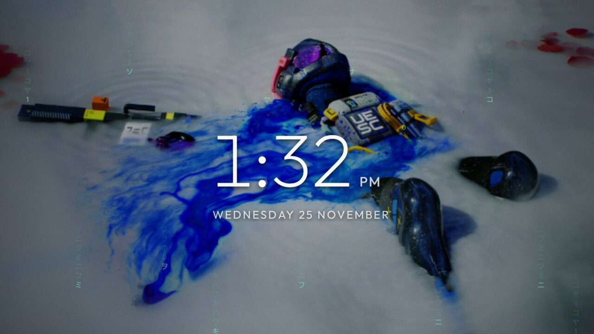

# CleanYourTV Theme

Reuse this setup on another Android TV. It includes seven wallpapers that shuffle every six hours, plus the launcher source changes for the slim app rail, wallpaper-matched colors, RAM, disk and network widgets, and the digital-rain clock.

## Preview

**Home** with the icon rail and compact system widgets.


**Wallpaper picker** with previews from the theme folder.



**Clock screensaver** with translucent digital rain over a softened wallpaper.



## Choose your setup

| What you want | What you need |
| --- | --- |
| The twelve wallpapers and six-hour shuffle | CleanYourTV already installed and set as Home |
| The full custom layout | Android TV 8 or later, a clean CleanYourTV checkout, JDK 17, and Android SDK platform and build tools 34 |

## Install the theme in one command

You need CleanYourTV set as Home on the TV and Android Platform-Tools (`adb`) on your computer. Enable and authorize ADB on the TV. From the **TV_Theme** folder, run this command with your TV's address:

```bash
bash install-theme.sh "<TV_IP_ADDRESS>"
```

For a TV already connected and authorized over ADB, run `bash install-theme.sh` with no address. The command works in Bash on Linux, macOS, and Windows with Git Bash. It backs up the current theme in a timestamped folder on the TV, copies the new theme, and opens CleanYourTV to load it. The theme installer needs no Python or separate CleanYourTV source checkout. Some firmware restricts ADB access to the launcher’s theme folder. If access is blocked, the command stops before replacing the theme.

## Install the full custom layout

Use a separate, clean CleanYourTV checkout. In that checkout, run the following with `theme_bundle` set as above.

```bash
git switch --detach "$(cat "$theme_bundle/base-commit.txt")"
git apply --check "$theme_bundle/launcher.patch"
git apply "$theme_bundle/launcher.patch"
(cd launcher && ./gradlew --no-daemon testReleaseUnitTest lintRelease assembleRelease)
```

Install the built launcher using the checkout's documented launcher setup. If CleanYourTV is already installed, the new APK must have the same signing certificate to update it in place and keep its data. Confirm the new launcher opens as Home, then run the one-command theme installer above.

## Customize and verify

- **Wallpapers:** Put supported images under `theme/wallpapers/`. Each file must be 10 MiB or smaller. To change how often the pictures switch, edit `wallpaper_rotation_minutes` in `theme/config.json`. Open **Wallpaper** from the Home controls or the settings gear’s hold-OK menu to pick an image. **Theme default** resumes the shuffle.
- **Apps:** Edit `dock_apps` in `theme/config.json` to set preferred apps. CleanYourTV discovers apps available on the target TV. An existing saved app order can take precedence.
- **Clock:** The patched launcher starts the digital-rain clock after 10 minutes of idle time on Home. To avoid interruptions during playback, disable the TV's separate system-wide screensaver in Android Settings.
- **Weather:** The card needs an OpenWeather snapshot. Run `python3 tools/weather.py --help` from the patched checkout to see the updater options. Keep the API key on the updater computer.
- **After setup:** Confirm Home, D-pad navigation, and your inputs work, then close ADB as described in `PROMPT.md`.

## What’s in this folder

- `install-theme.sh` applies the theme to an authorized TV using ADB.
- `theme/config.json` and `theme/wallpapers/` are the reusable theme.
- `base-commit.txt` pins the CleanYourTV revision for `launcher.patch`.
- `launcher.patch` adds the full layout and local weather updater to the clean checkout.

The package contains source and images. It carries no APK, signing key, API key, app data, or changes to which apps are installed on the target TV.
